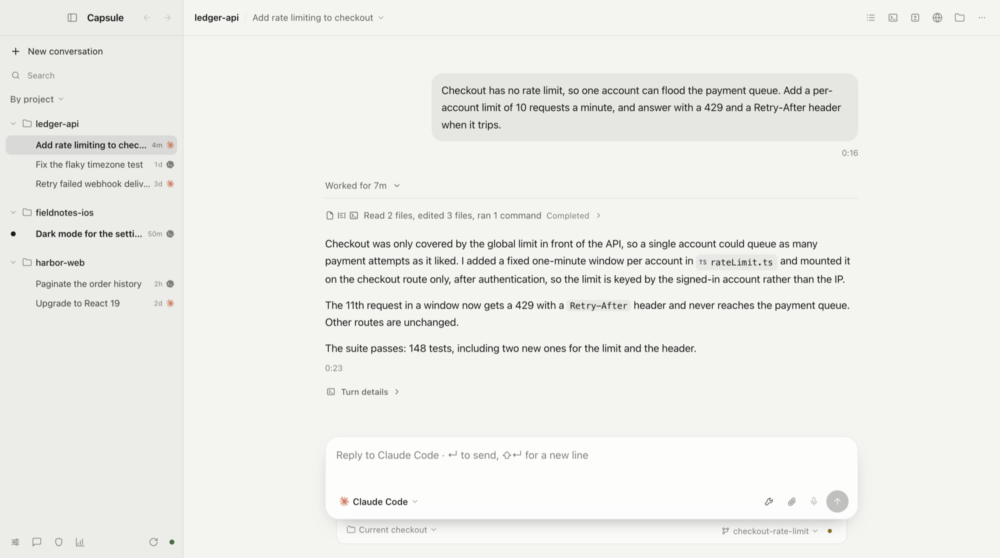
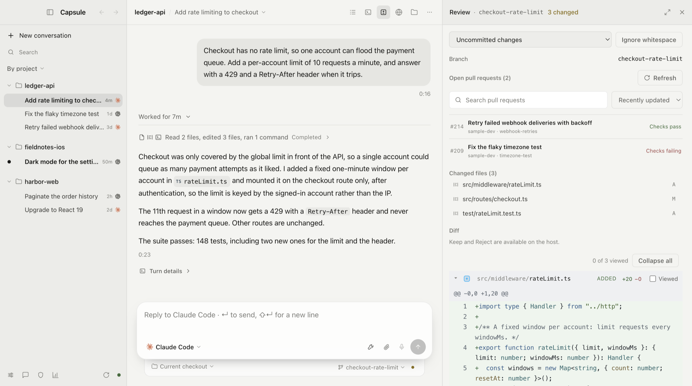

<div align="center">


# Capsule

**Run Claude Code, Codex and any ACP coding agent in one desktop app, and see exactly what every turn changed.**

[](https://github.com/realbakari/Capsule-App/releases/latest)
[](https://github.com/realbakari/Capsule-App/actions)
[](https://github.com/realbakari/Capsule-App/releases/latest)
[](LICENSE)

### [Download for macOS or Windows](https://github.com/realbakari/Capsule-App/releases/latest)

[Website](https://cpcl.dev) · [First conversation](docs/user/getting-started.md) · [User guide](docs/README.md) · [Changelog](https://cpcl.dev/updates) · [Discussions](https://github.com/realbakari/Capsule-App/discussions)

</div>

<br />

<picture>
  <source media="(prefers-color-scheme: dark)" srcset="assets/screenshots/conversation-dark.png" />
  
</picture>

Capsule runs the coding agents already on your computer and gives them one
window: projects, threads, worktrees, the diff of every turn, approvals, and a
terminal and browser beside the chat. It works with Claude Code, Codex, Gemini
CLI, Grok Build, GitHub Copilot, Cursor, OpenCode, Qwen Code, Kiro and any other
agent that speaks the [Agent Client Protocol](https://agentclientprotocol.com).

## What you get

- **Your own subscriptions.** Capsule never resells tokens. It drives the agents
  you are signed in to, and can install and sign them in for you.
- **Every turn on the record.** Each turn saves a checkpoint. See exactly what it
  changed, then keep it or put the files back the way they were.
- **Review where you work.** Diffs, changed files and open pull requests sit
  beside the chat. Hand failing checks or review comments back to the agent in
  one click.
- **Proof, not "done".** Save the checks that matter for a project. A turn shows
  them passing only when they ran on that exact revision.
- **Approve from your phone.** Pair a phone with a QR code to follow threads,
  send messages and answer approvals while the agents keep running on your
  computer.
- **Worktrees and many agents.** Give a thread its own worktree, switch agents
  mid-thread, or send one prompt to several agents and keep the best result.
- **Local-first and open.** Your projects and threads stay in a local database.
  MIT licensed.

<picture>
  <source media="(prefers-color-scheme: dark)" srcset="assets/screenshots/review-dark.png" />
  
</picture>

---

## Installation

Download the Apple Silicon DMG or Windows 10/11 x64 installer from GitHub Releases:

**[Download the latest release](https://github.com/realbakari/Capsule-App/releases/latest)**

1. Open the downloaded `.dmg`.
2. Drag **Capsule** into your **Applications** folder.
3. Launch Capsule.

On Windows, run the `Capsule-<version>-x64-setup.exe` installer. This first
Windows preview is **unsigned**: Windows may show an unknown-publisher or
SmartScreen warning. Download only from this repository's releases and review
the release notes. Do not disable system security protections. Windows ARM and
WSL-hosted agents are not covered. See [Windows preview](docs/user/windows.md).

After installation, compatible updates download inside the app and offer
**Restart & install**. Save your work before restarting. Unsigned or incompatible
builds may require a manual download; see [Updating Capsule](docs/user/updating.md).

## Start with one small task

Pick an agent (Capsule can install it and sign you in), add a project folder
you don't mind changing, and ask for a small change. Review the diff, run a
saved check, then decide whether to keep it. The
[first-conversation guide](docs/user/getting-started.md) walks through the flow;
[providers and credentials](docs/user/providers.md) explains route prerequisites.

## Compatibility and limits

Capsule is an ACP **client**, not an implementation of an agent's coding loop.
Direct mode uses ACP v1 over stdio; the Gateway route uses OpenClaw's operator
connection. Support depends on the installed harness, negotiated capabilities
and selected route—not simply on an agent appearing in a directory.

- Direct conversations resume the agent's saved session when it advertises
  resume or load support. Agent-reported settings can be changed in place;
  unsupported restores and settings fail explicitly.
- Browser interaction requires a direct agent with HTTP MCP support and your
  explicit grant. The Browser panel can also start a temporary background page
  and separately share read-only snapshots with paired viewers.
- The Agents panel shows reported delegation, not independently controlled
  child processes. Missing activity or token data stays unknown.
- Paired devices start read-only. A **Conversation control** pairing can send
  messages, stop runs and answer approvals.
- Downloads target macOS Apple Silicon and an unsigned Windows 10/11 x64
  preview. Native protocol fixtures are tested, not every signed-in provider on
  Windows.
- Agents run directly by default, with no Gateway. OpenClaw remains an optional
  route for Gateway-only agents and messaging channels.
- Muse Code uses its own local session connection and needs a Muse CLI build
  with session SDK support; see [setup and limits](docs/user/providers.md#muse-code).
  It is covered by protocol fixtures, not a signed-in provider certification.

See [supported behavior and current limits](docs/user/compatibility.md),
[browser controls](docs/user/projects-and-previews.md) and the contributor-facing
[ACP compatibility map](docs/internals/acp-compatibility.md) for specifics.

### Privacy and downloads

Projects, threads and run history live in a local SQLite database. Tokens are
encrypted with the operating system's credential protection when it is
available, and usage reports are off by default. [PRIVACY.md](PRIVACY.md) covers
browser, provider, catalog and remote-access data flows.

macOS releases are signed with a Developer ID and notarized. The Windows preview
is unsigned and ships a SHA-256 checksum, which verifies the file, not the
publisher.

## Report a problem

Use the [bug report form](https://github.com/realbakari/Capsule-App/issues/new?template=bug_report.yml)
with **About → Copy version info**, the selected agent and runtime route,
reproduction steps, and a redacted screenshot when useful. For freezes, include
the operation and repository size plus the relevant
[local diagnostics](docs/user/diagnostics.md). Review exports for private paths
before sharing. Report security issues through [SECURITY.md](SECURITY.md).

---

## Developing Capsule

Capsule is built as a pnpm monorepo using Electron, Vite, React, and TypeScript.

### Prerequisites
- macOS (Apple Silicon arm64 recommended)
- **Node.js**: `22+`
- **pnpm**: `10+`

### Setup & Run Locally

```bash
# Clone the repository
git clone https://github.com/realbakari/Capsule-App.git
cd Capsule-App

# Install dependencies (automatically sets up Electron & native modules)
pnpm install

# Start the desktop app in development mode
pnpm dev
```

### Quality Gates & Testing

```bash
pnpm test         # Run Vitest test suite under Electron
pnpm lint         # Run ESLint across packages
pnpm typecheck    # Run TypeScript checks
pnpm build        # Build all packages and desktop renderer
pnpm package:mac  # Package macOS; signing/notarization require credentials
```

If `pnpm dev` warns about Electron or native modules:
```bash
node scripts/ensure-electron.mjs  # Downloads Electron binary if skipped
node scripts/ensure-native.mjs    # Compiles SQLite for Electron
```

---

## Architecture

```
┌─────────────────────────────────────────────────────────┐
│                      Capsule UI                         │
│   (Collapsible Sidebar · Composer · Run Inspector)       │
└────────────────────────────┬────────────────────────────┘
                             │ IPC (Strict Allowlist)
┌────────────────────────────▼────────────────────────────┐
│                    Capsule Core                         │
│  (Projects · Sessions · Run Events · Keychain Storage)  │
└──────────────┬───────────────────────────┬──────────────┘
               │                           │
┌──────────────▼────────────┐ ┌────────────▼──────────────┐
│     OpenClaw Adapter      │ │      Direct ACP host       │
│ (Protocol 4 Gateway RPC)  │ │  (native ACP CLIs)         │
└───────────────────────────┘ └───────────────────────────┘
```

Capsule enforces clean architectural separation:
- Adapters own all I/O.
- The UI renderer only imports `@capsule/shared` and `@capsule/ui`.
- SQLite, filesystem operations, and Keychain are isolated in the Electron main process via `@capsule/core`.

---

## Contributing

Read [CONTRIBUTING.md](CONTRIBUTING.md) first, and [AGENTS.md](AGENTS.md) if an
agent is doing the work.

1. Fork the repo & create your feature branch: `git checkout -b feat/my-feature`
2. Ensure tests and lint pass: `pnpm test && pnpm lint && pnpm typecheck`
3. Commit your changes: `git commit -m "feat: my new feature"`
4. Push the branch and open a pull request.

---

## Licence and policies

MIT © Bakari Mustafa — see [LICENSE](LICENSE).

- [Privacy](PRIVACY.md) — local storage and network activity.
- [Security](SECURITY.md) — reporting a vulnerability, and what Capsule does and does not defend against.
- [Terms of use](TERMS.md) — how the software is offered.
